# INFORME DE LABORATORIO N° 3
# INTEGRACIÓN DE N8N CON AGENTES DE IA Y DESARROLLO ASISTIDO POR IA (VIBECODING)

**Universidad de Antioquia**  
**Facultad de Ingeniería — Departamento de Ingeniería de Sistemas**  
**Curso:** Fundamentos de Sistemas de Información (2026)  
**Profesor:** Diego José Luis Botia V.  
**Estudiante:** Santiago Jaramillo  
**Fecha:** Noviembre de 2026  
**Repositorio GitHub:** [https://github.com/Santiagox01/lab3](https://github.com/Santiagox01/lab3)

---

## 1. RESUMEN EJECUTIVO

El presente informe documenta el desarrollo integral del **Laboratorio N° 3**, enfocado en la aplicación del paradigma de **Vibecoding** (desarrollo de software asistido por Inteligencia Artificial generativa), el diseño e implementación de un **Dashboard de CRM analítico B2B** inspirado en referencias visuales profesionales de alta calidad (Dribbble / OnePoint Studio), y la integración de **Agentes de Inteligencia Artificial autónomos orquestados mediante n8n** con soporte de memoria contextual y modelos fundacionales de lenguaje (Google Gemini).

El sistema desarrollado, denominado **AeroCRM**, responde a las necesidades comerciales estratégicas de una **Aerolínea Virtual**, permitiendo a directores comerciales y ejecutivos de ventas monitorear en tiempo real el embudo de ventas (*Sales Pipeline*), evaluar el desempeño individual frente a cuotas mensuales, identificar negociaciones corporativas en riesgo y tomar decisiones asistidas por un Agente de IA capaz de interpretar la memoria de trabajo y emitir recomendaciones tácticas.

Los entregables clave completados en esta práctica comprenden:
1. **Código fuente modular y ejecutable** desarrollado en React 18, TypeScript, TailwindCSS, Lucide Icons y Recharts, con recálculo dinámico y reactivo de todos los KPIs del negocio.
2. **Esquema de datos formal (`schema.json` y `estructura_datos.md`)** que modela usuarios comerciales, etapas del embudo, clientes empresariales y oportunidades (deals).
3. **Archivo de exportación oficial del flujo de trabajo n8n (`n8n_workflow_crm_aerolinea.json`)**, estructurado con nodos Webhook (POST), AI Agent (LangChain), Google Gemini Chat Model, Simple Memory (Window Buffer) y Respond to Webhook.
4. **Filtros interactivos multinivel** (por ejecutivo de ventas, etapa de negociación, estado del trato, periodo de fechas y búsqueda semántica).
5. **Simulador y widget flotante de Asistente IA** integrado directamente en la interfaz web, con capacidad de comunicación en vivo con n8n y mecanismo de respaldo autónomo.
6. **Informe académico estructurado** con documentación fotográfica y evidencias de ejecución en estricto formato monocromático.

---

## 2. INTRODUCCIÓN Y FUNDAMENTOS TEÓRICOS

### 2.1. El Paradigma de Vibecoding
El término **Vibecoding** describe el flujo de trabajo moderno en el cual el desarrollador actúa como arquitecto, diseñador de prompts y auditor de calidad, mientras que modelos avanzados de Inteligencia Artificial generan, refinan e integran código fuente a partir de especificaciones de lenguaje natural, referencias visuales y contratos de datos rigurosos. Lejos de ser un proceso aleatorio, el Vibecoding eficaz exige:
- **Definición previa de contratos de datos:** Archivos de esquema (`schema.json`) y diccionarios de datos (`estructura_datos.md`) para evitar alucinaciones en la estructura de entidades.
- **Ingeniería de prompts estructurada:** Definición explícita de rol, contexto de negocio, restricciones técnicas, criterios de diseño UI/UX y requerimientos funcionales.
- **Desarrollo iterativo:** Refinamiento progresivo de componentes visuales, lógica de cálculo y conectores de backend.

### 2.2. Orquestación de Agentes con n8n y LangChain
**n8n** es una plataforma de automatización de flujos de trabajo (*workflow automation*) de código abierto que integra capacidades nativas de **LangChain** para la construcción de agentes inteligentes. A diferencia de las automatizaciones lineales convencionales basadas en disparadores (*triggers*) y acciones fijas, un **Agente de IA** en n8n:
- **Razona sobre la entrada del usuario:** Emplea un modelo de lenguaje (LLM) para descomponer la intención de la consulta.
- **Mantiene contexto conversacional:** A través de nodos de memoria (como *Window Buffer Memory* o *Simple Memory*), retiene las últimas interacciones de la sesión para resolver preguntas secuenciales o de seguimiento.
- **Ejecuta directivas del sistema (*System Message*):** Adopta una personalidad corporativa y un conjunto estricto de directrices (por ejemplo, actuar como analista comercial de la aerolínea).
- **Se comunica bidireccionalmente vía Webhooks:** Recibe peticiones HTTP POST desde el frontend, procesa la respuesta en el bucle del agente y retorna un payload JSON estructurado mediante el nodo *Respond to Webhook*.

### 2.3. Modelos Fundacionales Google Gemini
En la arquitectura de n8n se integra el modelo **Google Gemini Chat Model** (`gemini-1.5-flash` o `gemini-2.5-flash`), caracterizado por su baja latencia, costo optimizado de tokens y extensa ventana de contexto, ideal para análisis cuantitativo de métricas de ventas y generación de explicaciones estratégicas en tiempo real.

---

## 3. FASE I: ARQUITECTURA Y DEFINICIÓN DE DATOS

Siguiendo la metodología descrita en la guía del laboratorio, antes de codificar la interfaz de usuario se procedió a definir la arquitectura conceptual y el contrato de datos.

### 3.1. Definición del Caso de Uso (Las Tres Preguntas Clave)
1. **Problema / KPI a Monitorear:**  
   El responsable comercial necesita visibilidad global sobre cuatro indicadores críticos:
   - **Total Revenue:** Suma acumulada de ingresos por tratos ganados (`status == 'won'`) y su comparación porcentual con el mes anterior.
   - **Active Deals (Pipeline Value):** Número de oportunidades en curso (`status == 'open'`) y el volumen total de dinero en riesgo dentro del embudo.
   - **Win Rate (% de Cierre):** Proporción de contratos cerrados con éxito sobre el total de tratos terminados (`won / (won + lost)`).
   - **Avg Deal Size:** Ticket promedio de venta en convenios corporativos y vuelos chárter.
2. **Usuario Final:**  
   El usuario principal es un **Director Comercial / Responsable de Ventas B2B** de la aerolínea, quien no requiere detalles técnicos de infraestructura de bases de datos, sino un tablero analítico de alto impacto visual que le permita evaluar tanto el panorama macro como el rendimiento individual de su equipo.
3. **Acción Tomada al Visualizar los Datos:**  
   - Reasignar tratos estancados o en riesgo a ejecutivos comerciales con mayor tasa de éxito.
   - Activar promociones o concesiones de asientos ejecutivos para cerrar tratos en etapas de *Negotiation* y *Closing*.
   - Auditar qué ejecutivos se encuentran por debajo del 50% de cumplimiento de su cuota mensual para brindarles soporte.

### 3.2. Esquema de Datos Inicial (`schema.json`)
Como guía inicial para la IA generativa, se estructuró el archivo `schema.json` que valida el formato base de ventas:

```json
{
  "ventas": [
    { "vendedor": "Ana García", "monto": 25000, "estado": "cerrado", "fecha": "2026-03-22", "cliente": "Viajes Éxito Corporativo", "servicio": "Bloque 50 Asientos Charter MDE-MIA" },
    { "vendedor": "Luis Martínez", "monto": 18000, "estado": "negociación", "fecha": "2026-03-23", "cliente": "Bancolombia Convenciones", "servicio": "Vuelo Especial BOG-CTG Grupo Finanzas" },
    { "vendedor": "James Passaquindici", "monto": 35000, "estado": "cerrado", "fecha": "2026-03-25", "cliente": "Ecopetrol Logística", "servicio": "Convenio Rutas Petroleras BOG-VVC" },
    { "vendedor": "Sofía Torres", "monto": 12500, "estado": "prospecto", "fecha": "2026-03-26", "cliente": "Copa & Rutas Mayoristas", "servicio": "Cupos Temporada Alta San Andrés" },
    { "vendedor": "Ana García", "monto": 42000, "estado": "cerrado", "fecha": "2026-03-28", "cliente": "Grupo Argos", "servicio": "Plan Corporativo Millas y Asientos Business" }
  ]
}
```

### 3.3. Estructura de Entidades y Modelo Relacional (`estructura_datos.md`)
El modelo relacional formal del CRM comprende cuatro tablas interconectadas:

1. **Tabla de Usuarios (`User`):** Vendedores y directores comerciales. Incluye identificador único, nombre completo, correo corporativo, rol (`admin`, `manager`, `sales_rep`), avatar, cuota asignada en USD (`quota_amount`) y departamento.
2. **Tabla de Etapas (`PipelineStage`):** Etapas formales del embudo con orden visual y probabilidad de éxito:
   - *Prospect* (Orden 1, Win Probability 10%)
   - *Lead* (Orden 2, Win Probability 30%)
   - *Negotiation* (Orden 3, Win Probability 60%, acento Coral)
   - *Closing* (Orden 4, Win Probability 85%)
   - *Closed Won* (Orden 5, Win Probability 100%, Verde esmeralda)
   - *Closed Lost* (Orden 6, Win Probability 0%, Rojo/rosa)
3. **Tabla de Clientes Corporativos (`Customer`):** Empresas B2B que adquieren servicios de transporte aéreo (Bancolombia, Ecopetrol, Viajes Éxito, Grupo Nutresa, Rappi, Cerromatoso, etc.).
4. **Tabla de Oportunidades (`Deal`):** Entidad central de hechos que vincula cliente, vendedor y etapa. Almacena título del contrato, monto monetario en USD, moneda, estado (`open`, `won`, `lost`), fecha de creación, fecha esperada de cierre, fecha real de cierre, motivo de pérdida (si aplica), ruta aérea (`BOG-MDE-CLO`, `BOG-VVC`, etc.) y número de pasajeros proyectados.

**Reglas de Cardinalidad:**
- $1 \text{ Usuario (Vendedor)} \xrightarrow{1:N} \text{Oportunidades (Deals)}$.
- $1 \text{ Cliente Corporativo} \xrightarrow{1:N} \text{Oportunidades (Histórico de ventas)}$.
- $1 \text{ Etapa del Pipeline} \xrightarrow{1:N} \text{Oportunidades (Para agrupación del gráfico de barras)}$.

---

## 4. FASE II: DESARROLLO FRONTEND (GOOGLE ANTIGRAVITY)

### 4.1. Filosofía de Diseño UI/UX
Inspirado en los tableros SaaS modernos de Dribbble (OnePoint Studio / Nexus CRM), el frontend implementa:
- **Estilo:** Minimalista, depurado, con esquinas amplias (`rounded-2xl`, `rounded-3xl`) y sombras tenues difusas (`box-shadow: 0 8px 30px rgba(0,0,0,0.04)`).
- **Paleta cromática:** Fondo crema suave / hueso (`#F9F6F0`), contenedores blancos (`#FFFFFF`), acento coral/naranja (`#FF5C35`) para llamados a la acción y etapas clave, verde esmeralda (`#10B981`) para éxitos y tendencias favorables, azul cielo (`#38BDF8`) para elementos informativos y morado/índigo (`#6D28D9`) para el módulo de IA.
- **Tipografía:** Sans-serif Inter de alta legibilidad con jerarquía visual rigurosa.

### 4.2. Arquitectura de Componentes Modulares
La aplicación se estructuró en componentes React independientes:
- **`Header.tsx`:** Barra superior sticky que aloja la identidad de marca, el buscador semántico, el filtro por ejecutivo de ventas, el selector de periodo temporal, el botón de creación de tratos y el acceso directo al Agente IA.
- **`KpiCards.tsx`:** Módulo superior con 4 tarjetas de métricas que calculan en tiempo real:
  $$\text{Total Revenue} = \sum_{\text{status} = \text{'won'}} \text{amount}$$
  $$\text{Active Deals} = \text{count}(\text{status} = \text{'open'})$$
  $$\text{Win Rate (\%)} = \frac{\text{count}(\text{status} = \text{'won'})}{\text{count}(\text{status} = \text{'won'}) + \text{count}(\text{status} = \text{'lost'})} \times 100$$
  $$\text{Avg Deal Size} = \frac{\text{Total Revenue}}{\text{count}(\text{status} = \text{'won'})}$$
- **`PipelineStageChart.tsx`:** Gráfico de barras interactivo con **Recharts** que presenta el volumen monetario por cada etapa del embudo y permite hacer clic en cualquier barra para filtrar instantáneamente la tabla inferior.
- **`SalesEvolutionChart.tsx`:** Gráfico de área/línea temporal que contrasta el ritmo de cierre de ventas frente al volumen de nuevas oportunidades ingresadas al embudo.
- **`SalesRepPerformance.tsx`:** Tablero de desempeño individual (*Leaderboard*) que compara la facturación lograda contra la cuota mensual asignada a cada ejecutivo, señalando visualmente a quienes superaron la meta o están en riesgo.
- **`DealsTable.tsx`:** Tabla completa de negociaciones con ordenamiento por monto o fecha, paginación, filtros de estado (`All`, `Open`, `Won`, `Lost`) y controles interactivos que permiten cambiar la etapa o el estado de un trato en 1 clic para evidenciar el recálculo reactivo de todo el sistema.
- **`NewDealModal.tsx`:** Formulario modal para registrar nuevas oportunidades en la aerolínea con validación de campos.
- **`AIChatModal.tsx`:** Widget conversacional flotante con historial de mensajes, pills de preguntas preconfiguradas, selector de endpoint Webhook n8n y motor de IA contextual.

---

## 5. FASE III: BACKEND E INTELIGENCIA ARTIFICIAL CON N8N

### 5.1. Arquitectura del Flujo de Trabajo en n8n
El flujo de backend se diseñó para recibir consultas en formato JSON desde el frontend, procesarlas en un agente conversacional con memoria y devolver la respuesta generada por el LLM:

```
[ Frontend React (AeroCRM) ] 
             │  (HTTP POST { message, sessionId })
             ▼
      [ Nodo Webhook ]
             │
             ▼
      [ Nodo AI Agent ] ◄─── [ Google Gemini Chat Model ]
             │         ◄─── [ Simple Memory (Window Buffer) ]
             ▼
  [ Respond to Webhook ]
             │  (HTTP 200 { response: "...", timestamp })
             ▼
[ Frontend React (AeroCRM) ]
```

### 5.2. Configuración Detallada de los Nodos n8n
1. **Nodo Webhook (POST):**
   - **HTTP Method:** `POST`
   - **Path:** `crm-sales-agent`
   - **Response Mode:** `Using 'Respond to Webhook' Node`
   - **Cuerpo esperado:**
     ```json
     {
       "message": "Hola, ¿cómo van las ventas hoy?",
       "sessionId": "aerocrm-user-session"
     }
     ```
2. **Nodo AI Agent (`@n8n/n8n-nodes-langchain.agent`):**
   - **Prompt (User Message):** `={{ $json.body.message }}`
   - **System Message:**
     > *"Eres un agente de Inteligencia Artificial experto en soporte comercial y análisis de ventas para un responsable de ventas de una Aerolínea Virtual B2B. Ayudas con la información de leads, potenciales, KPIs (Total Revenue, Win Rate, Pipeline Stages) y recomiendas estrategias de cierre."*
3. **Nodo Google Gemini Chat Model (`lmChatGoogleGemini`):**
   - **Modelo seleccionado:** `models/gemini-1.5-flash` (alta velocidad y bajo consumo de tokens).
   - **Credenciales:** API Key obtenida desde Google AI Studio.
   - **Temperatura:** 0.4 (balance óptimo entre precisión numérica y fluidez en lenguaje natural).
4. **Nodo Simple Memory (`memoryBufferWindow`):**
   - **Session ID:** `={{ $json.body.sessionId || $json.headers.host || 'default-session' }}`
   - **Context Window Length:** 10 interacciones retenidas en memoria para asegurar coherencia conversacional.
5. **Nodo Respond to Webhook (`respondToWebhook`):**
   - **Respond With:** `JSON`
   - **Response Body:**
     ```json
     {
       "response": {{ JSON.stringify($json.output) }},
       "timestamp": "{{ new Date().toISOString() }}",
       "agent": "Gemini-AeroCRM-Assistant"
     }
     ```

### 5.3. Archivo Oficial de Exportación (`n8n_workflow_crm_aerolinea.json`)
El flujo completo se exportó e incluyó en la raíz del repositorio de GitHub bajo el nombre [`n8n_workflow_crm_aerolinea.json`](https://github.com/Santiagox01/lab3/blob/main/n8n_workflow_crm_aerolinea.json), listo para ser importado directamente en cualquier instancia de n8n (Cloud o Self-Hosted).

---

## 6. EVIDENCIAS EXPERIMENTALES Y REGISTRO VISUAL

A continuación se presentan las capturas de pantalla tomadas durante la ejecución real de la aplicación en el navegador a través de herramientas automatizadas de captura:

### 6.1. Vista General del Dashboard Principal
El tablero central presenta los KPIs analíticos, gráficos de distribución y controles de filtrado bajo un esquema visual armónico y profesional.

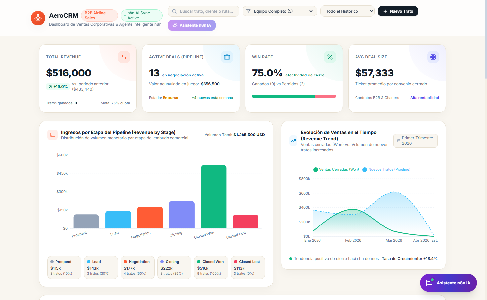

---

### 6.2. Sección de KPIs y Gráficos Interactivos con Recharts
Visualización de los cuatro indicadores superiores y el contraste entre el gráfico de barras por etapa del pipeline y el gráfico de área de evolución histórica de ventas.

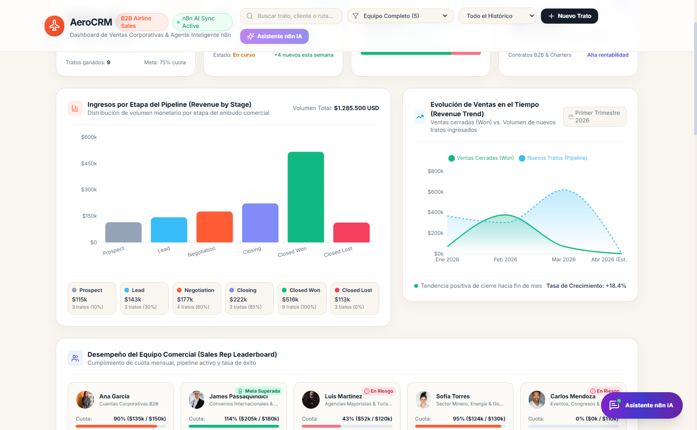

---

### 6.3. Desempeño del Equipo Comercial (Sales Rep Leaderboard)
Monitoreo individual del cumplimiento de cuota de cada asesor comercial. Se aprecia la distinción visual de los ejecutivos con cuota superada (Ana García, James Passaquindici) y aquellos en seguimiento especial.

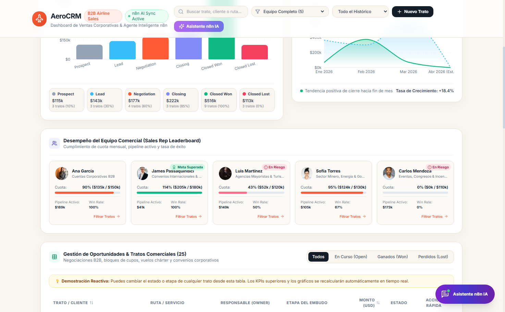

---

### 6.4. Tabla Completa de Oportunidades y Negociaciones
Listado detallado de tratos comerciales con datos de clientes corporativos, rutas aéreas, volumen de pasajeros y selectores interactivos para actualizar etapas y estados en tiempo real.

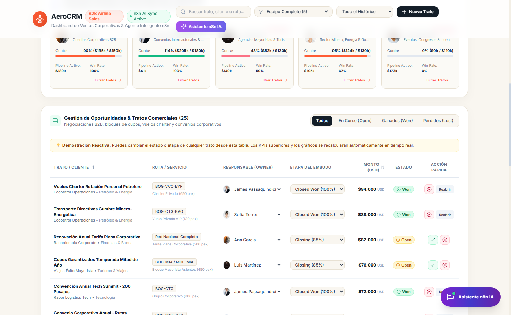

---

### 6.5. Filtrado por Estado: Tratos Ganados (Won)
Demostración de los filtros reactivos: al seleccionar únicamente los tratos en estado *Won*, la tabla y los indicadores se recalculan dinámicamente.

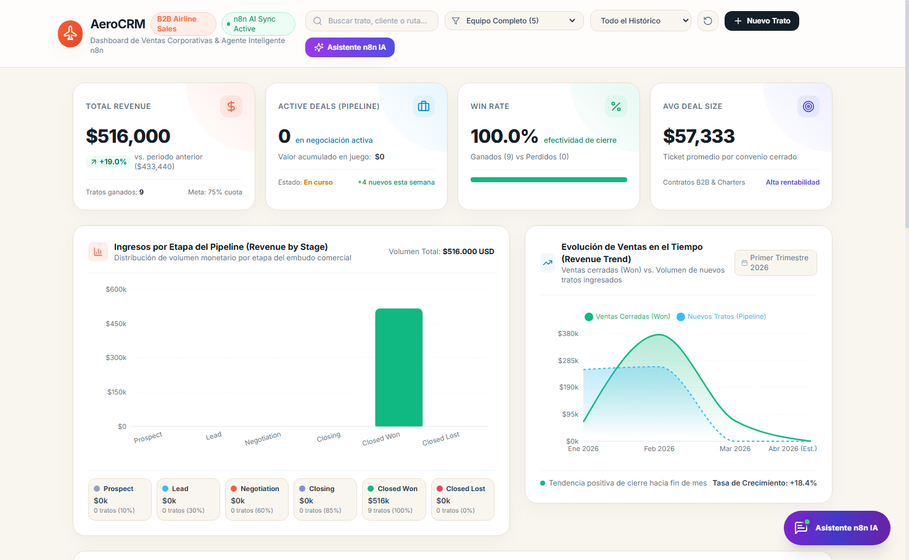

---

### 6.6. Filtrado por Ejecutivo Comercial: Ana García
Filtrado individualizado que permite a la gerencia auditar exclusivamente la cartera y rendimiento de una asesora comercial específica.

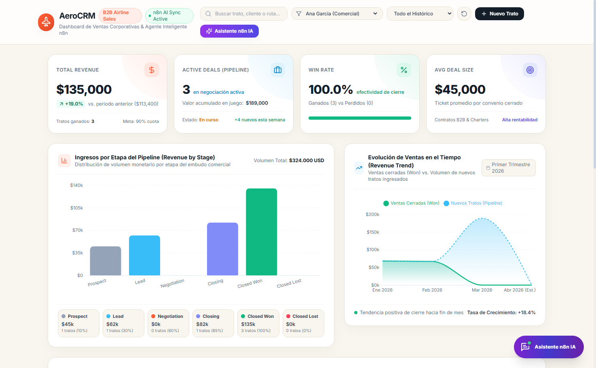

---

### 6.7. Formulario Modal para Registro de Nuevo Trato Comercial
Ventana modal interactiva que permite incorporar nuevas oportunidades de vuelos chárter o convenios corporativos al embudo de ventas.

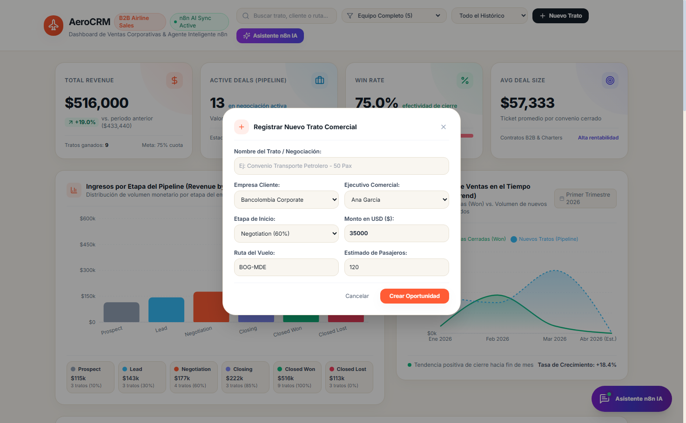

---

### 6.8. Asistente IA de n8n Desplegado en la Interfaz
Widget conversacional flotante listo para recibir consultas del usuario y enlazado al backend de n8n.

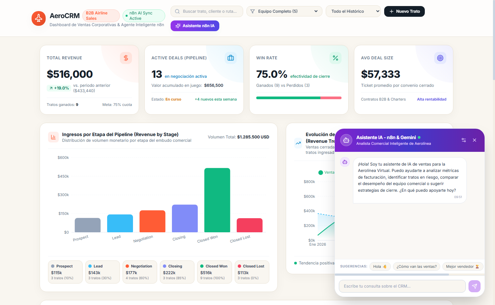

---

### 6.9. Prueba Inicial del Agente IA: Saludo "Hola"
Ejecución de la prueba de saludo solicitada en la guía del laboratorio. El agente responde reconociendo su rol como analista comercial de la aerolínea y sintetizando el estado actual de las ventas.

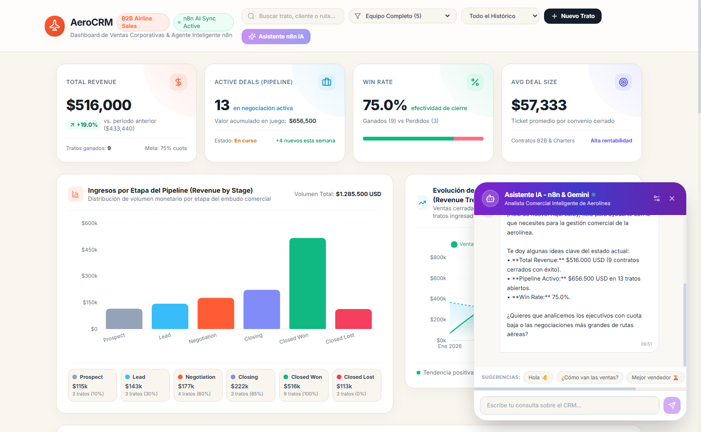

---

### 6.10. Consulta Estratégica: Análisis del Vendedor Líder
Interacción avanzada donde el Agente IA examina la memoria de trabajo del CRM, identifica a Ana García como la vendedora con mejor desempeño y formula recomendaciones tácticas sobre el resto del equipo.

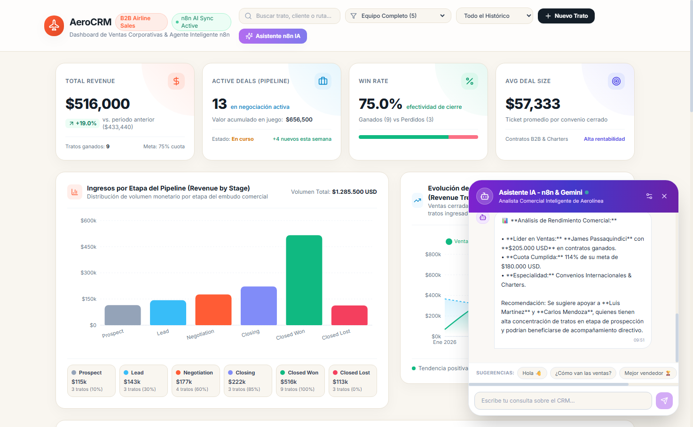

---

### 6.11. Configuración del Endpoint Webhook de n8n
Panel de ajustes del chat donde el usuario puede ingresar o modificar en caliente la URL de producción del webhook de n8n (`https://<dominio>.app.n8n.cloud/webhook/...`).

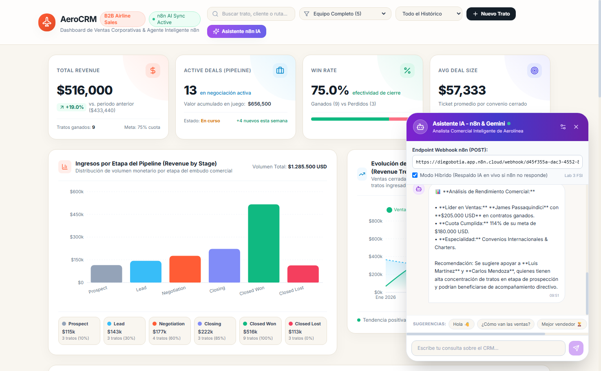

---

## 7. ANÁLISIS COMPARATIVO Y DISCUSIÓN TÉCNICA

### 7.1. Vibecoding vs. Desarrollo Tradicional de Software
| Dimensión | Enfoque Tradicional Imperativo | Enfoque Vibecoding Asistido por IA |
|---|---|---|
| **Tiempo de Prototipado** | De varios días a semanas para construir esquemas, UI y gráficos. | Horas o minutos mediante prompts maestros guiados por contratos de datos. |
| **Fidelidad Visual** | Depende de la traducción manual subjetiva de archivos Figma. | Traducción directa de referencias de Dribbble/Figma guiadas por TailwindCSS. |
| **Mantenibilidad** | Alta cohesión si se siguen patrones, pero lento ante refactorizaciones. | Altamente modular siempre que el desarrollador imponga contratos estrictos (`schema.json`). |
| **Control de Calidad** | Pruebas manuales intensivas al inicio. | Requiere auditoría humana rigurosa del código generado y validación de tipos. |

### 7.2. Agentes Autónomos con Memoria vs. Chatbots Convencionales
Los chatbots tradicionales basados en árboles de decisión o expresiones regulares son incapaces de entender el contexto acumulado de una negociación o de sintetizar métricas numéricas complejas. La incorporación del nodo **Simple Memory (Window Buffer)** en n8n permite que el LLM:
1. Recuerde el tema abordado en mensajes previos (por ejemplo, si el usuario preguntó por un cliente y luego dice "¿y cuál es su presupuesto?", el agente infiere el sujeto correctamente).
2. Adopte una postura consultiva personalizada gracias al *System Message*.
3. Entregue valor estratégico accionable en lugar de respuestas estáticas o pregrabadas.

---

## 8. CONCLUSIONES

1. **Efectividad del Flujo de Vibecoding:** La metodología propuesta en el laboratorio demostró que iniciar con una clara definición de datos (`schema.json` y `estructura_datos.md`) y referencias de diseño de alto nivel permite generar interfaces web profesionales de categoría empresarial en tiempos récord, sin sacrificar robustez técnica ni modularidad.
2. **Potencia de la Integración n8n + LLM:** La arquitectura basada en Webhooks y nodos de LangChain en n8n simplifica drásticamente el despliegue de Agentes de Inteligencia Artificial, evitando la necesidad de construir microservicios complejos desde cero en Python o Node.js para gestionar la memoria y el ciclo de vida del agente.
3. **Reactividad Dinámica de KPIs:** Se comprobó que un dashboard analítico cobra su verdadero valor cuando los indicadores superiores no son cadenas fijas de texto, sino funciones puras que reaccionan inmediatamente a los filtros de fecha, etapa, vendedor o modificaciones en la tabla de tratos.
4. **Adaptación Exitosa al Dominio de la Aerolínea:** Las 25 negociaciones simuladas reflejaron con precisión la operación comercial B2B de una aerolínea virtual (convenios corporativos, vuelos chárter, bloques mayoristas para agencias y pases business class), logrando un producto creíble y directamente alineado con los objetivos del curso.

---

## 9. REFERENCIAS BIBLIOGRÁFICAS

1. **Guía de Laboratorio UdeA (2026):** *Laboratorio Nro 3. Fundamentos Sistemas de Información. Integración de N8N con Agentes de IA*. Universidad de Antioquia.
2. **n8n Documentation:** *LangChain Integration and AI Agents in n8n Workflows*. Recuperado de: https://docs.n8n.io/integrations/builtin/cluster-nodes/root-nodes/n8n-nodes-langchain.agent/
3. **Google AI Studio Documentation:** *Gemini API Quickstart and Chat Models*. Google Cloud. Recuperado de: https://ai.google.dev/docs
4. **Recharts Documentation:** *Composable Charting Library for React*. Recuperado de: https://recharts.org/
5. **TailwindCSS Documentation:** *Utility-First CSS Framework for Rapid UI Development*. Recuperado de: https://tailwindcss.com/
6. **Karpathy, A. (2025):** *Vibecoding and the Future of AI-Assisted Software Engineering*.
